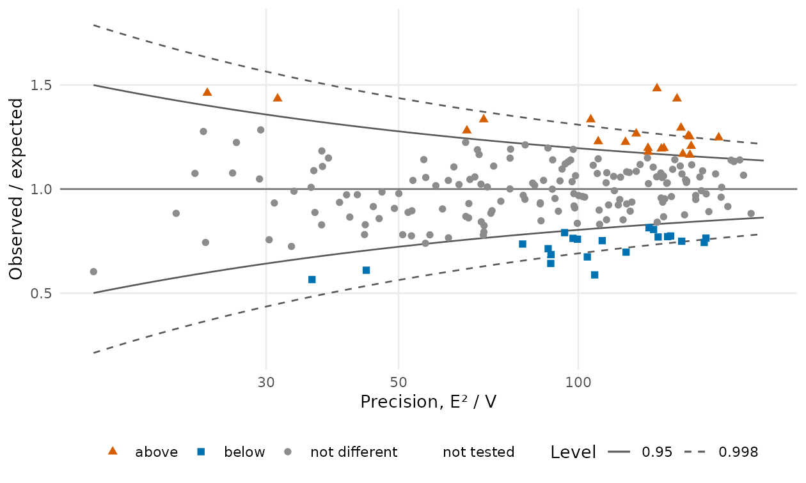
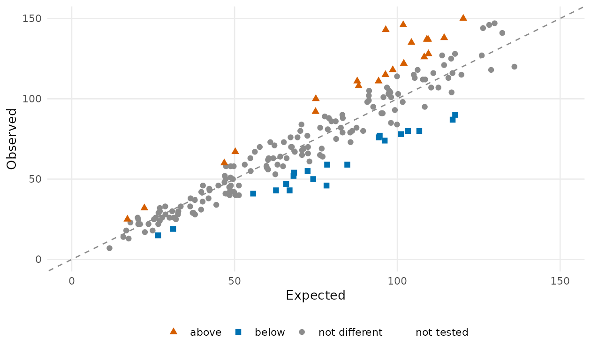

# pprof

<!-- badges: start -->
[](https://github.com/UM-KevinHe/pprof/actions/workflows/R-CMD-check.yaml)
[](https://um-kevinhe.github.io/pprof/)
[](https://www.r-project.org/)
<!-- badges: end -->

**pprof** provides statistical methods for provider profiling, the comparison of health care providers on patient outcomes after adjustment for differences in case mix. The package implements each step of constructing a quality measure: Risk adjustment fits models with provider-specific fixed, random, or correlated random effects for binary, continuous, and time-to-event outcomes, with optional penalized selection of risk factors. Standardization computes indirectly and directly standardized ratios, rates, and differences. Inference tests each provider against a national norm using score and Wald statistics with model-based, robust, or stabilized variances, as well as exact and likelihood ratio tests, referred to either the theoretical null or an empirical null. The package also provides a comprehensive set of plots for provider profiling, including caterpillar and funnel plots, observed-versus-expected plots, the fitted reference distribution, reliability, and variable selection paths.


## Installation

```r
# install.packages("remotes")
remotes::install_github("UM-KevinHe/pprof", ref = "Yubo")
```

A C++17 compiler is needed (Rtools on Windows, the Xcode command-line tools
on macOS); OpenMP is used when available.

## One analysis in ten lines

```r
library(pprof)

d  <- sim_kecc(n_providers = 200, seed = 1)           # or your own data frame
pd <- pp_data(d, y = "y", x = c("x1", "x2", "x3"),     # declare the columns
              provider = "provider", patient = "patient", cutoff = 10)

fit <- fit_logistic_fe(pd)                            # logistic model, one effect per provider
summary(fit)                                          # the risk-factor coefficients

sm  <- standardize(fit, type = "indirect")            # observed / expected per provider
tst <- test(fit, statistic = "score")                 # one score test per provider
tst                                                   # flags: 1 above, -1 below, 0 not different

plot(tst)                                             # caterpillar plot
plot(tst, type = "funnel")                            # funnel plot with the test's limits
plot(sm, test = tst)                                  # observed against expected
```

## What is inside

Every measure is built on the same linear predictor, η = γ<sub>*i*</sub> +
*Z*<sup>⊤</sup>β: the outcome chooses the model, the arguments choose the
variant, and a measure is the chain of these steps.

```
pp_data()                 data: declare the outcome, risk factors, provider and patient columns;
│                         trials for a binomial outcome; time, event and start for a time to event
│
├── risk adjustment       one model, one effect per provider
│   ├── fit_*()                          fixed effects        random effects       correlated random effects
│   │     binary / binomial outcome      fit_logistic_fe()    fit_logistic_re()    fit_logistic_cre()
│   │     continuous outcome             fit_linear_fe()      fit_linear_re()      fit_linear_cre()
│   │     time to event                  fit_cox()            stratified by provider; two-stage with x2
│   ├── coef()  vcov()  summary()        coefficients, their variances, tests of the risk factors
│   └── var_select(data, penalty = "lasso" | "group_lasso"),  cv(),  selected_covariates()
│                                        risk-factor selection with the provider effects unpenalized
│
├── standardized measures
│   ├── standardize(fit, type = "indirect" | "direct")
│   │                                    one ratio, rate or difference per provider, with observed and expected
│   └── direct_expectation()             the direct standardization for effects supplied by hand
│
├── testing               is a provider different from the reference?
│   ├── test(fit, statistic, variance, null_model)        one test per provider, flag 1 / 0 / -1
│   │     logistic   statistic = exact | score | wald | lr    variance = naive | robust | stabilized
│   │     linear     statistic = wald                         variance = naive | robust
│   │     cox        statistic = midp | exact | wald          dispersion = none | deviance
│   ├── null_model("theoretical" | "empirical" | "fixed")   the reference distribution of the statistics
│   │     calibrate(test, null_model)                       the flags and limits under that reference
│   ├── confint(fit)                                        intervals for the provider effects
│   └── test_measure(estimate, se, reference)               the test of a standardized measure
│
├── reliability
│   └── iur("direct" | "bootstrap" | "split_half"),  iur_curve(),  iur_stratified()
│
└── plots
    ├── plot()            caterpillar | funnel | bar of a test; observed against expected of a measure;
    │                     forest of the coefficients; the fitted null; reliability; selection path and cv
    └── flag_stability()  the flags under alternative choices
```

<p align="center">
  
  
</p>

## Learn more

* [Get started](https://um-kevinhe.github.io/pprof/articles/pprof.html): the concepts and one complete analysis
* One article per step: [data](https://um-kevinhe.github.io/pprof/articles/data.html) ·
  [risk-adjustment models](https://um-kevinhe.github.io/pprof/articles/models.html) ·
  [variable selection](https://um-kevinhe.github.io/pprof/articles/selection.html) ·
  [standardized measures](https://um-kevinhe.github.io/pprof/articles/standardization.html) ·
  [tests](https://um-kevinhe.github.io/pprof/articles/testing.html) ·
  [reference distributions](https://um-kevinhe.github.io/pprof/articles/null.html) ·
  [reliability](https://um-kevinhe.github.io/pprof/articles/reliability.html) ·
  [plots](https://um-kevinhe.github.io/pprof/articles/plots.html)
* [Function reference](https://um-kevinhe.github.io/pprof/reference/index.html), grouped the same way

## Getting help

Open an issue at <https://github.com/UM-KevinHe/pprof/issues> or write to
<ybshao@umich.edu> or <kevinhe@umich.edu>.
