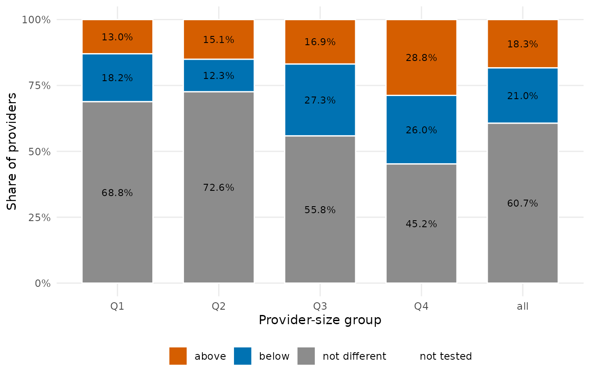
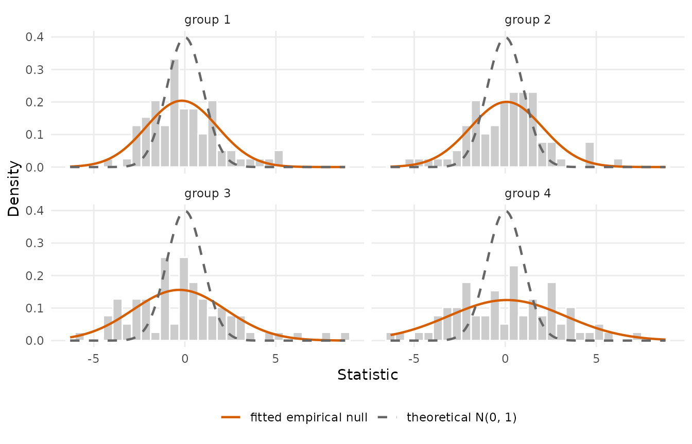
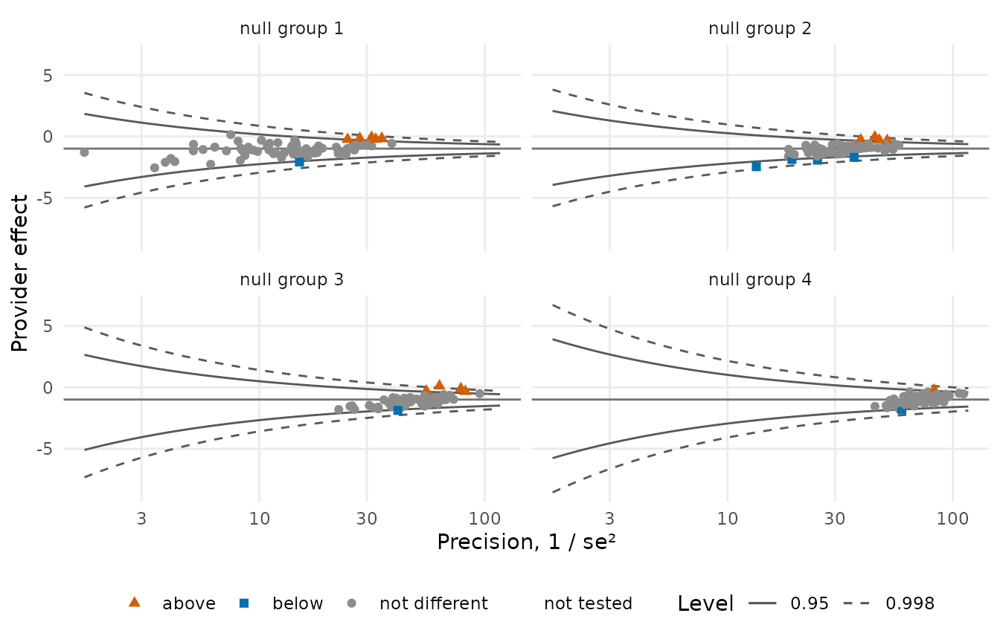

# Reference distributions

Whichever statistic is chosen, it must be referred to a distribution,
and this choice is independent of the statistic and its variance.
Testing against the **theoretical null** \\N(0, 1)\\ asks “does this
provider differ from the national average?”. Testing against an
**empirical null** asks “is this provider extreme relative to how much
providers of similar size ordinarily vary?”. The second is the question
a measure intends to ask, because between-provider variation that no
adjustment model captures is not something a provider can be held to
account for (Kalbfleisch and Wolfe 2013; Efron 2004).

## Why the theoretical null miscalibrates

Suppose that beyond what the risk model explains, providers of ordinary
quality differ by a random amount, \\\gamma_i = \gamma_0 + u_i\\ with
\\u_i \sim N(0, \tau^2)\\. A Wald statistic is then marginally \\N(0,
1 + \tau^2 / s_i^2)\\, more dispersed than the theoretical null by an
amount that grows with the provider’s precision: large providers, whose
own sampling error is small, are the ones the theoretical null misjudges
most. In profiling data the statistics are routinely two to three times
as dispersed as \\N(0, 1)\\, and tested against it a third of the large
providers can be flagged.

``` r

library(pprof)
d <- sim_kecc(n_providers = 300, provider_size = c(10, 150), gamma_sd = 0.4, seed = 21)
pd <- pp_data(d, y = "y", x = c("x1", "x2", "x3"), provider = "provider",
              patient = "patient", message = FALSE)
fit <- fit_logistic_fe(pd)
tst <- test(fit, statistic = "wald", variance = "robust")
plot(tst, type = "bar")
```



## The empirical null

The null is estimated from the bulk of the statistics themselves:
providers are stratified by size, and within each stratum a normal
distribution \\N(\mu_g, \sigma_g^2)\\ is fitted to the centre of the
histogram by robust M-estimation (Huber’s psi with the MAD scale, by
default), so that genuine outliers do not determine the reference
against which they are judged. Stratification by size is essential,
since the overdispersion is itself size-dependent and a single null
over-corrects small providers and under-corrects large ones.

``` r

en <- null_model("empirical", tst, n_groups = 4)
en
#> Empirical null: 4 group(s) by rank, huber estimator
#>  group n_providers n_fitted min_size max_size null_mean null_sd converged
#>      1          75       75       10       49  -0.16542   1.955      TRUE
#>      2          75       75       49       74   0.07151   1.990      TRUE
#>      3          75       75       75      115  -0.29633   2.559      TRUE
#>      4          75       75      115      150   0.09212   3.200      TRUE
plot(en)
```



Arguments of `null_model("empirical", ...)`:

- `z`: a test result (its statistics, providers and sizes are used) or a
  numeric vector; `size`: one size per provider, when not the test’s own
  (person-time for the survival measures);
- `n_groups` and `grouping`: `"rank"` (default; the providers sorted by
  size dealt into consecutive blocks of `ceiling(n / k)`, the convention
  of the patient-month measures), `"quantile"` (groups by the empirical
  quantiles of the size, the convention of the survival measures) or
  `"cut"` (the sorted providers cut into intervals of equal length);
  `groups` gives explicit labels;
- `estimator`: `"huber"` (default), `"bisquare"` or `"mm"`, with
  `tuning`, `maxit`, `acc`;
- `common_mean`: replace the groups’ locations by one pooled mean or a
  number; `fit_mask`: the providers that enter the fits;
- `min_group_size`, `small_group`: what to do with a group too small to
  fit.

The result (`pp_null`) carries the mean and standard deviation of every
provider’s null, its group, and a `diagnostics` table with the fitted
parameters, the number of providers and the convergence of each group.

## Calibrating a test

[`calibrate()`](https://um-kevinhe.github.io/pprof/reference/calibrate.md)
refers the statistics to the null: the adjusted statistic \\(z - \mu_g)
/ \sigma_g\\ replaces the standard normal in the p-values and flags, and
the limits are those of the inverted calibrated test, \\\hat\theta -
(\mu_g \pm c\\\sigma_g)\\ se\\ (for the mid-p test of a Cox fit, by root
finding), so that a limit excludes the null value exactly when the
provider is flagged.

``` r

cal <- calibrate(tst, en)
cal
#> Provider tests: wald statistic, robust variance; null median = -0.9935; two.sided, level 0.95
#>   300 providers: 14 above, 7 below, 279 not different, 0 not tested
#>  provider estimate     se null_value statistic z_adjusted null_mean null_sd
#>      P001  -0.8343 0.1664    -0.9935    0.9568     0.4449   0.07151   1.990
#>      P002  -0.3834 0.3524    -0.9935    1.7312     0.9700  -0.16542   1.955
#>      P003  -0.8023 0.1737    -0.9935    1.1008     0.5172   0.07151   1.990
#>      P004  -0.9269 0.1556    -0.9935    0.4281     0.1792   0.07151   1.990
#>      P005  -0.6834 0.2658    -0.9935    1.1669     0.6814  -0.16542   1.955
#>      P006  -0.7239 0.1898    -0.9935    1.4205     0.8111  -0.16542   1.955
#>  null_group      p flag  lower   upper
#>           2 0.6564    0 -1.495 -0.1973
#>           1 0.3320    0 -1.676  1.0253
#>           2 0.6050    0 -1.492 -0.1372
#>           2 0.8578    0 -1.545 -0.3311
#>           1 0.4956    0 -1.658  0.3790
#>           1 0.4173    0 -1.420  0.0348
#>   ... 294 more rows
table(theoretical = tst$flag, empirical = cal$flag)
#>            empirical
#> theoretical  -1   0   1
#>          -1   7  56   0
#>          0    0 182   0
#>          1    0  41  14
plot(cal, type = "funnel")
```



The same in one call, with the null fitted on the result:

``` r

same <- test(fit, statistic = "wald", variance = "robust", null_model = "empirical")
identical(same$flag, cal$flag)
#> [1] TRUE
```

`null_model` accepts a null kind by name (defaults), a `pp_null` object,
or a function of the result returning one, for other settings:

``` r

test(fit, statistic = "score", variance = "robust",
     null_model = function(t) null_model("empirical", t, grouping = "quantile", n_groups = 4))
```

`critical` replaces the normal quantile of `level` by a fixed critical
value for the flags and limits.

## Other nulls

- `null_model("theoretical")`: \\N(0, 1)\\, the default of every test.
- `null_model("fixed", mean = 0, sd = 1.8)`: a known inflation, for
  instance the scale a measure’s documentation fixes from earlier years.
- `test_measure(location = , scale = )`: the same for a measure-level
  test, one value or one per provider; or `null_model` as above.

``` r

head(calibrate(tst, null_model("fixed", sd = 1.8)))
#> Provider tests: wald statistic, robust variance; null median = -0.9935; two.sided, level 0.95
#>   6 providers: 0 above, 0 below, 6 not different, 0 not tested
#>  provider estimate     se null_value statistic z_adjusted null_mean null_sd
#>      P001  -0.8343 0.1664    -0.9935    0.9568     0.5316         0     1.8
#>      P002  -0.3834 0.3524    -0.9935    1.7312     0.9618         0     1.8
#>      P003  -0.8023 0.1737    -0.9935    1.1008     0.6116         0     1.8
#>      P004  -0.9269 0.1556    -0.9935    0.4281     0.2379         0     1.8
#>      P005  -0.6834 0.2658    -0.9935    1.1669     0.6483         0     1.8
#>      P006  -0.7239 0.1898    -0.9935    1.4205     0.7892         0     1.8
#>  null_group      p flag  lower    upper
#>          NA 0.5950    0 -1.421 -0.24734
#>          NA 0.3361    0 -1.627  0.85976
#>          NA 0.5408    0 -1.415 -0.18948
#>          NA 0.8120    0 -1.476 -0.37792
#>          NA 0.5168    0 -1.621  0.25419
#>          NA 0.4300    0 -1.393 -0.05435
```

## Decisions and comparisons

Two consequences of the empirical null deserve emphasis. It is a
*simultaneous* inference device as much as a variance correction:
several thousand providers are tested at once, and the null is estimated
from the centre of the observed statistics rather than assumed. And any
comparison between measures, or between tests, must hold the reference
distribution fixed, or the comparison is uninterpretable: a difference
in flag counts may be entirely a difference in reference.
[`flag_stability()`](https://um-kevinhe.github.io/pprof/reference/flag_stability.md)
lays the flags of several choices side by side:

``` r

flag_stability(theoretical = tst, empirical = cal,
               quantile_groups = test(fit, statistic = "wald", variance = "robust",
                                      null_model = function(t) {
                                        null_model("empirical", t, grouping = "quantile")
                                      }))
#> Flags under 3 scenarios: 118 providers (19 flagged under every scenario)
#>  provider theoretical empirical quantile_groups n_flagged
#>      P064           1         1               1         3
#>      P071          -1        -1              -1         3
#>      P085           1         1               1         3
#>      P116          -1        -1              -1         3
#>      P120           1         1               1         3
#>      P145           1         1               1         3
#>      P164           1         1               1         3
#>      P167           1         1               1         3
#>      P184          -1        -1              -1         3
#>      P193           1         1               1         3
#>   ... 108 more rows
```

## References

Efron B (2004). Large-scale simultaneous hypothesis testing: the choice
of a null hypothesis. *Journal of the American Statistical Association*,
99(465), 96-104.

Kalbfleisch JD, Wolfe RA (2013). On monitoring outcomes of medical
providers. *Statistics in Biosciences*, 5, 286-302.
