# Plots

Every result object has a
[`plot()`](https://rdrr.io/r/graphics/plot.default.html) method that
returns a ggplot, so the display can be modified with the usual `+` and
saved with
[`ggplot2::ggsave()`](https://ggplot2.tidyverse.org/reference/ggsave.html).
The colours and shapes are the same on every display: providers
**above** the reference in orange triangles, **below** in blue squares,
**not different** in grey circles, **not tested** in light grey crosses.

``` r

library(pprof)
d <- sim_kecc(n_providers = 150, provider_size = c(12, 100), seed = 11)
pd <- pp_data(d, y = "y", x = c("x1", "x2", "x3"), provider = "provider",
              patient = "patient", message = FALSE)
fit <- fit_logistic_fe(pd)
tst <- test(fit, statistic = "wald", variance = "robust", null_model = "empirical")
```

## Caterpillar plot

Every provider’s estimate and interval in order of the estimate,
coloured by its flag, with the reference as a dashed line. The intervals
are those of the test (calibrated when the test was), so an interval
excludes the reference exactly when the provider is flagged.

``` r

plot(tst)
```

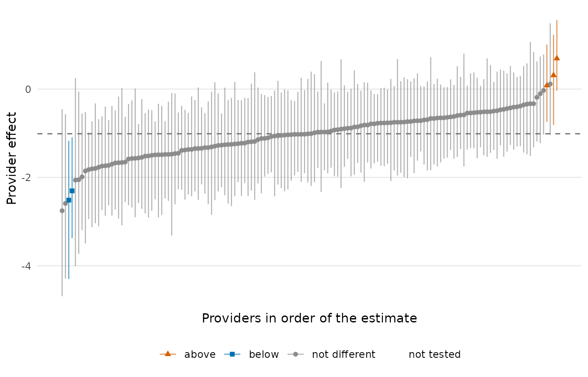

``` r

plot(tst, highlight = tst$provider[tst$flag == 1][1:3])
```

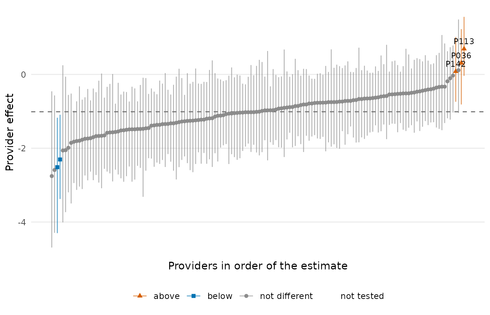

## Funnel plot

Estimates against precision, with control limits from the same test as
the flags: a provider outside the limits is a flagged provider, nothing
else. For a test with standard errors the x axis is \\1 / se^2\\ and the
limits are \\\theta_0 \pm c \cdot se\\ at the test’s level (solid) and
at 0.998 (dashed); when the test was calibrated with an empirical null
there is one panel per null group, each with its own limits.

``` r

plot(tst, type = "funnel")
```

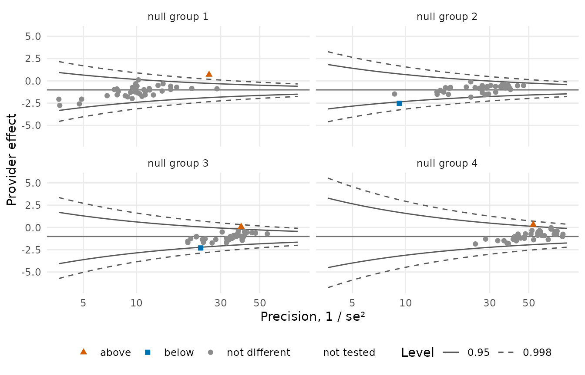

For the Poisson tests of a Cox fit the x axis is the expected number of
events and the limits are the counts the test flags at every expected
count:

``` r

s <- sim_kecc(n_providers = 120, provider_size = c(15, 80), type = "survival", seed = 3)
ps <- pp_data(s, x = c("x1", "x2", "x3"), provider = "provider", patient = "patient",
              time = "stop", start = "start", event = "event", cutoff = 0, message = FALSE)
cox <- fit_cox(ps)
plot(test(cox, min_expected = 2), type = "funnel")
```

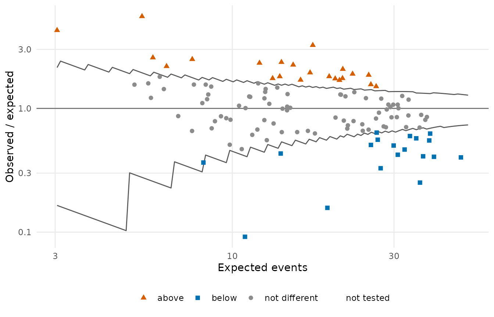

## Flags by provider size

The shares of providers flagged above, below and not different, within
quartiles of provider size and overall. The display behind the empirical
null: under the theoretical null the share of flagged providers grows
with size.

``` r

plot(test(fit, statistic = "wald", variance = "robust"), type = "bar")
```

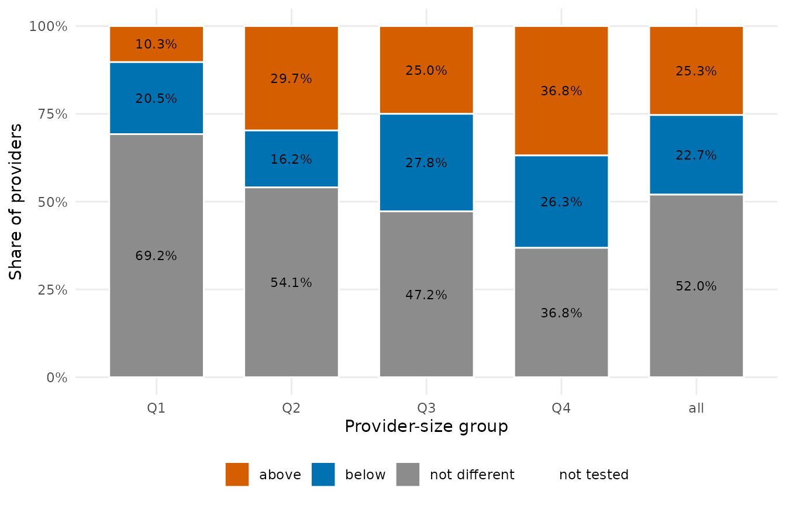

``` r

plot(tst, type = "bar")
```

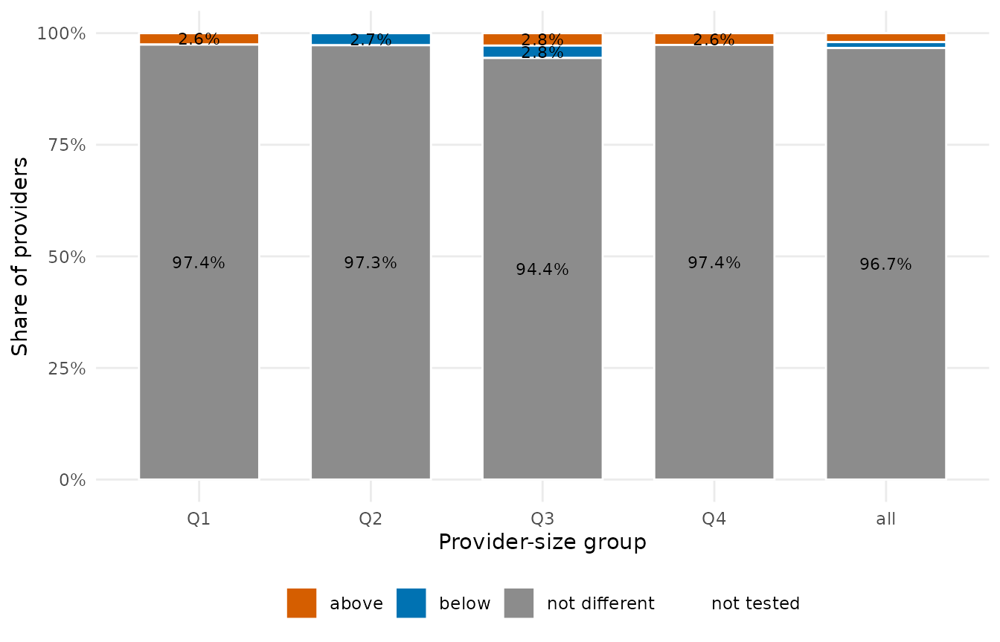

## Observed against expected

A
[`standardize()`](https://um-kevinhe.github.io/pprof/reference/standardize.md)
result draws the observed total against the expected one with the
diagonal; pass the test to colour the providers. `type = "funnel"` draws
the ratio against its precision \\E^2 / V\\ with normal limits.

``` r

sm <- standardize(fit)
plot(sm, test = tst)
```

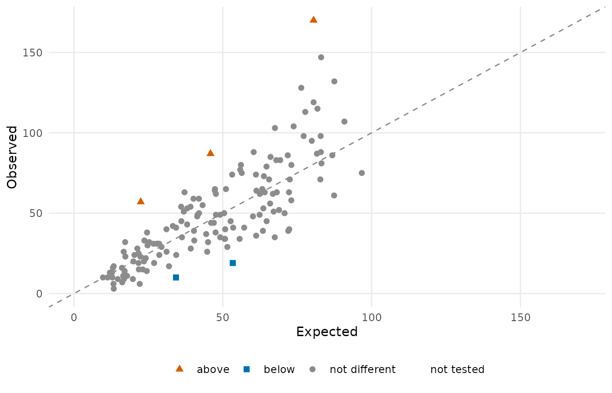

``` r

plot(sm, type = "funnel", test = tst)
```

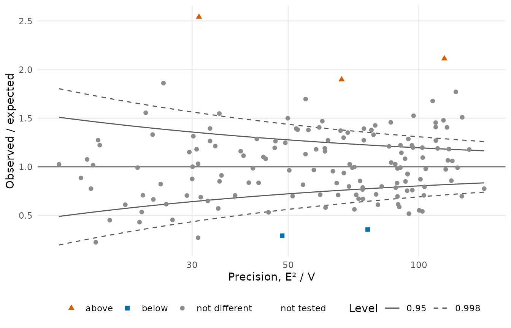

## Forest plot of the coefficients

``` r

plot(summary(fit, test = "robust_wald"))
#> `height` was translated to `width`.
```

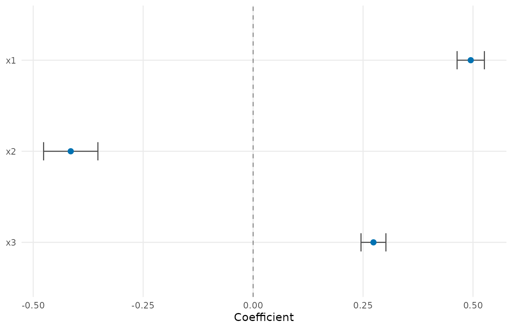

``` r

plot(summary(fit), exponentiate = TRUE)
#> `height` was translated to `width`.
```

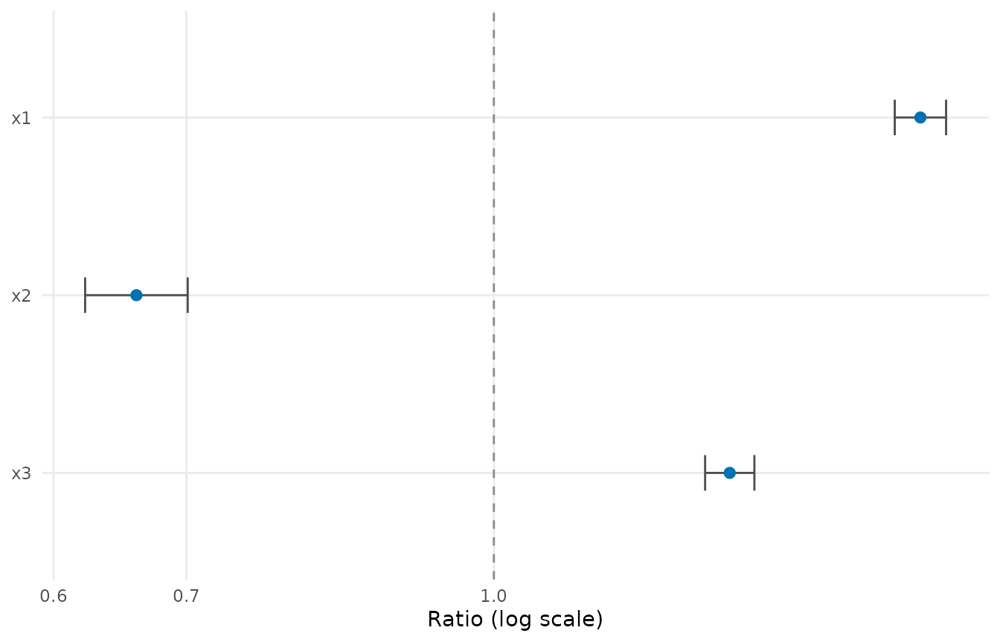

## Null calibration

The statistics against the theoretical and the fitted null, one panel
per size group: the display that shows why an empirical null is needed
and what it fitted.

``` r

plot(null_model("empirical", test(fit, statistic = "wald", variance = "robust")))
```

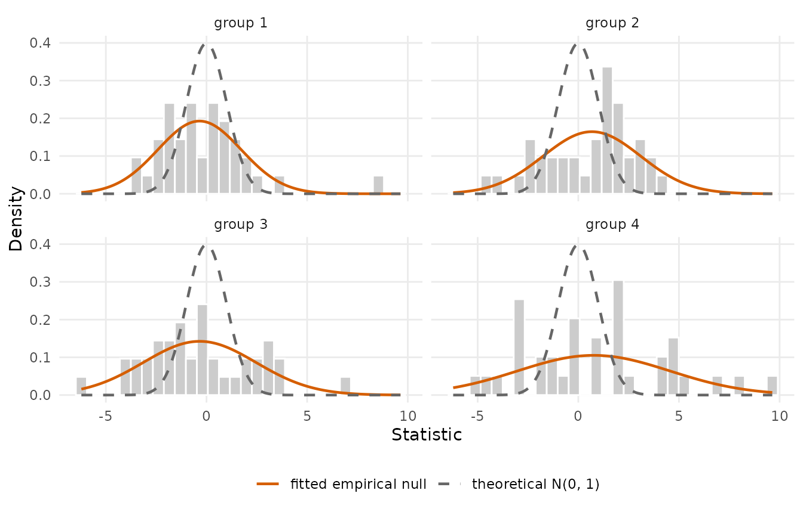

## Reliability curve

``` r

expected <- stats::plogis(stats::median(coef(fit)$gamma) + fit$linear_predictor)
plot(iur("bootstrap", obs = fit$data$y, expected = expected, provider = fit$data$provider,
         n_boot = 50, seed = 1))
```

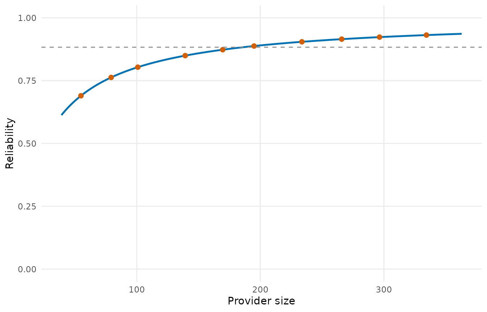

## Selection paths and cross-validation

``` r

d6 <- sim_kecc(n_providers = 60, n_covariates = 8, beta = c(0.6, -0.5, 0.4, 0, 0, 0, 0, 0),
               seed = 4)
pd6 <- pp_data(d6, y = "y", x = paste0("x", 1:8), provider = "provider", patient = "patient",
               message = FALSE)
path <- var_select(pd6, n_lambda = 30)
plot(path)
```

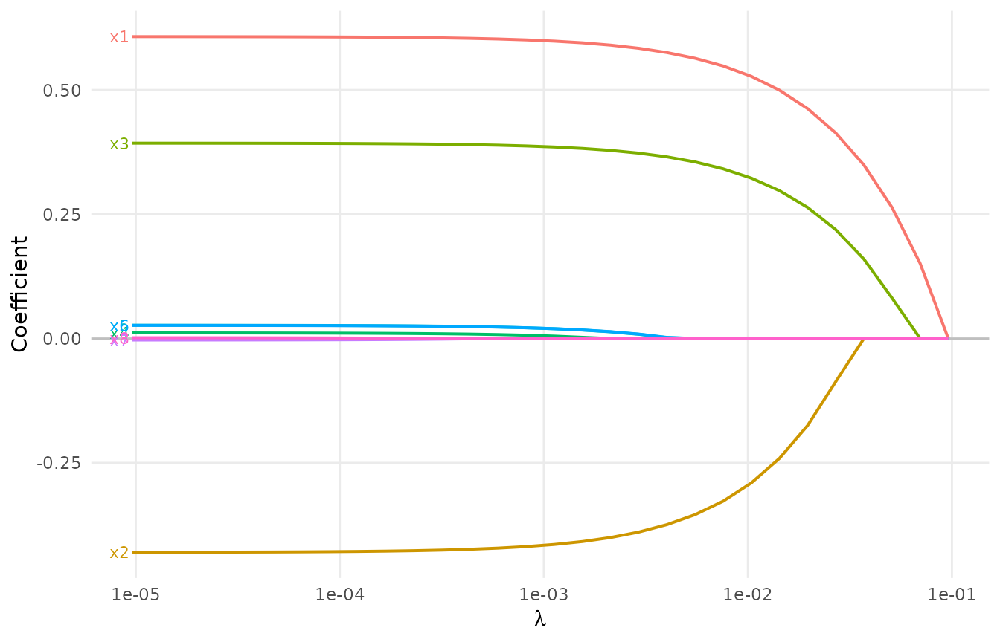

``` r

plot(cv(path, n_folds = 5, seed = 1))
```

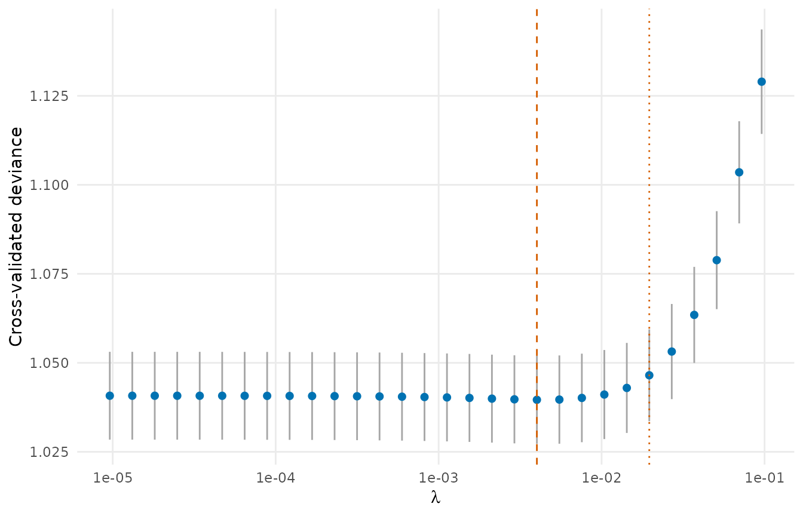

## Flags under the alternatives

[`flag_stability()`](https://um-kevinhe.github.io/pprof/reference/flag_stability.md)
lines up the flags of several tests, for the providers flagged by at
least one of them:

``` r

st <- flag_stability(
  wald_robust = test(fit, statistic = "wald", variance = "robust"),
  score_robust = test(fit, statistic = "score", variance = "robust"),
  empirical = tst,
  exact = test(fit, statistic = "exact"))
plot(st)
```

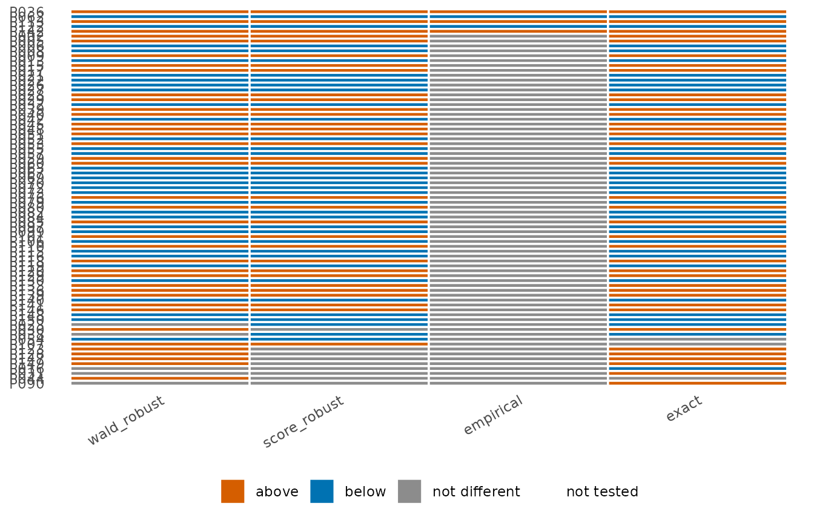
