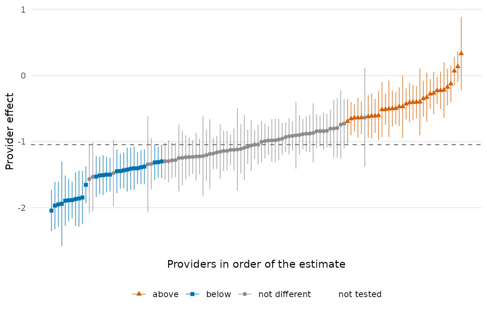
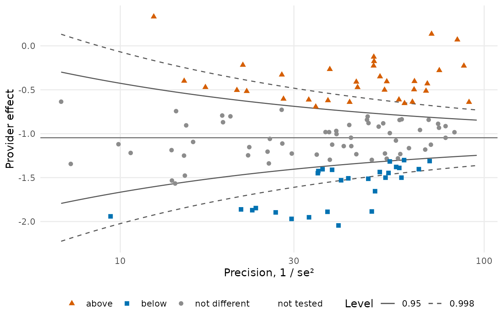
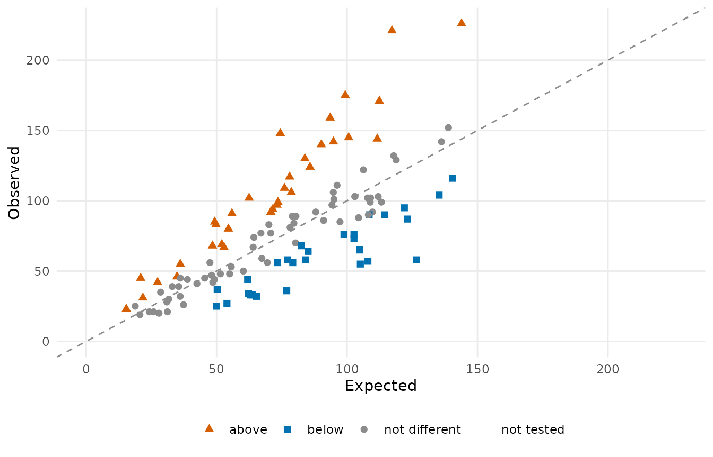
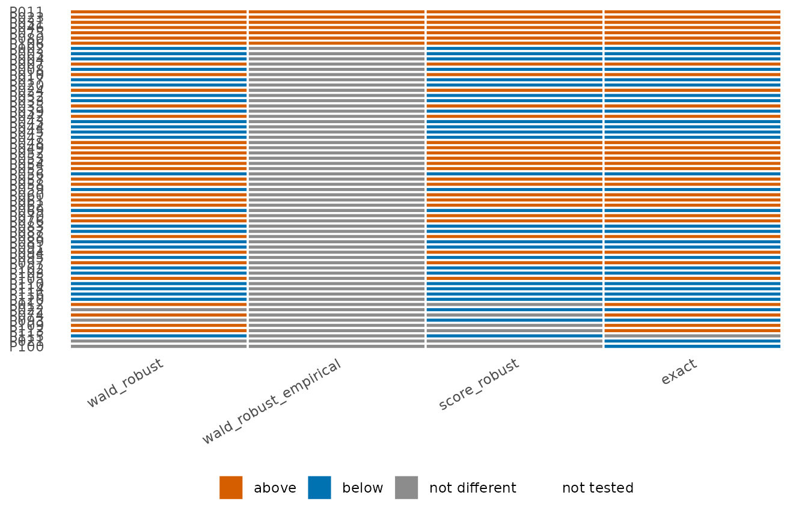

# Get started: the concepts and one complete analysis

## Why provider profiling, and why it is hard

Provider profiling identifies the health care providers whose quality of
care is unusually good or unusually poor. It is a standard instrument of
accountability in United States health policy: the Centers for Medicare
and Medicaid Services profiles every Medicare-certified dialysis
facility, hospital, nursing home, home health agency and transplant
program in the country. A profiling measure answers one question per
provider: *are this provider’s outcomes better, worse or no different
from what its patients would have experienced at a typical provider?*
The answer is a flag, and a flag carries consequences. A provider can
lose its Medicare certification; it can lose part of its payment, as
dialysis facilities do under the ESRD Quality Incentive Program; it can
be placed under surveillance and inspected; and it is rated in public,
where patients and referring clinicians read the rating.

Given these stakes, the procedure that produces a profile must be right
at each of its three steps, because an error at any step misclassifies a
provider: it imposes the consequences on a provider that has not earned
them, or spares one that has.

1.  **Risk adjustment.** Outcomes depend on the patients as well as on
    the care. A provider whose patients are older and sicker looks worse
    than it is, and without adjustment differences in patient mix are
    mistaken for differences in quality. The risk-adjustment model
    separates the two; the provider effects it yields are the input to
    everything after.
2.  **Standardized measures.** After adjustment, each provider is held
    against a national norm on one interpretable scale: the ratio or the
    difference between the outcome under the provider’s care and the
    outcome expected under the norm for the provider’s own patients.
3.  **Hypothesis testing.** A departure from the norm can arise by
    chance, and a small provider can depart widely through random
    variation alone. A test decides whether the departure is more than
    chance; only a significant departure becomes a flag.

Each step requires choices, and the defaults of general-purpose
regression software fail at exactly the places that matter in profiling,
silently: thousands of provider effects of wildly unequal size, which a
pooled model drops (biased) and a random-effects model shrinks (the
extremes are lost); two standardizations that answer different
questions; a Wald test that cannot flag a provider whose outcomes are
all identical; observations repeated within patients, so that the usual
variance is too small; and a theoretical null that flags large providers
for residual risk the claims data never measured. The articles on each
step explain the failure and the choice that avoids it: [risk-adjustment
models](https://um-kevinhe.github.io/pprof/articles/models.md),
[standardized
measures](https://um-kevinhe.github.io/pprof/articles/standardization.md),
[tests of provider
effects](https://um-kevinhe.github.io/pprof/articles/testing.md) and
[reference
distributions](https://um-kevinhe.github.io/pprof/articles/null.md).

**pprof** builds measures from components, one per analysis step, with
the choices as arguments. This page explains the concepts behind each
step and runs one analysis from data to report.

## The common framework

Every measure in the package is built on the same linear predictor. For
patient \\j\\ of provider \\i\\, observed on occasion \\k\\ (a
patient-month, a discharge, a period at risk):

\\\eta\_{ijk} = \gamma_i + Z\_{ijk}^\top \beta .\\

- \\\gamma_i\\ is the **provider effect**: everything about provider
  \\i\\ that the risk factors do not explain. The measure reports it, in
  one form or another, and the tests are tests of it.
- \\Z\_{ijk}\\ are the **risk factors** (case mix) with coefficients
  \\\beta\\: age, comorbidities, laboratory values. Adjusting for them
  is what makes the comparison fair.
- The outcome determines the model through which \\\eta\\ acts: a
  logistic model for a binary or binomial outcome, a linear model for a
  continuous one, a proportional-hazards model for a time to event.

Two facts about this model shape everything else. Each observation
belongs to exactly one provider, so the provider effects can be
estimated one provider at a time even when there are thousands of them.
And the number of observations per provider varies enormously, from a
handful to thousands, so the question “is this provider different?” is
asked with very different amounts of information from one provider to
the next.

### Observations are not independent

A patient contributes many observations (months, discharges, periods),
and those observations are correlated: a patient who is sicker than the
risk factors say is sicker in every month. The package keeps track of
the patient behind every row so that the tests can account for this
correlation (the *robust* and *stabilized* variances of the testing
step).

## The steps

| Step | The question it answers | Functions |
|:---|:---|:---|
| Data | Which columns are the outcome, the risk factors, the provider, the patient? | [`pp_data()`](https://um-kevinhe.github.io/pprof/reference/pp_data.md), [`pp_check()`](https://um-kevinhe.github.io/pprof/reference/pp_check.md) |
| Risk-adjustment model | What does each provider’s effect look like after adjusting for its patients? | [`fit_logistic_fe()`](https://um-kevinhe.github.io/pprof/reference/fit_logistic_fe.md), [`fit_linear_fe()`](https://um-kevinhe.github.io/pprof/reference/fit_linear_fe.md), [`fit_cox()`](https://um-kevinhe.github.io/pprof/reference/fit_cox.md), `fit_*_re()`, `fit_*_cre()` |
| Standardized measure | How does the provider’s outcome compare with what was expected? | [`standardize()`](https://um-kevinhe.github.io/pprof/reference/standardize.md), [`test_measure()`](https://um-kevinhe.github.io/pprof/reference/test_measure.md) |
| Test | Is the provider’s effect different from the reference, and in which direction? | [`test()`](https://um-kevinhe.github.io/pprof/reference/test.md), [`confint()`](https://rdrr.io/r/stats/confint.html), [`summary()`](https://rdrr.io/r/base/summary.html) |
| Reference distribution | Different from the reference, or unusual among providers of similar size? | [`null_model()`](https://um-kevinhe.github.io/pprof/reference/null_models.md), [`calibrate()`](https://um-kevinhe.github.io/pprof/reference/calibrate.md) |
| Reliability | How much of the variation between providers is signal rather than noise? | [`iur()`](https://um-kevinhe.github.io/pprof/reference/iur.md) |
| Variable selection | Which risk factors should the model carry? | [`var_select()`](https://um-kevinhe.github.io/pprof/reference/var_select.md), [`cv()`](https://um-kevinhe.github.io/pprof/reference/cv.md) |
| Plots | What does the result look like? | [`plot()`](https://rdrr.io/r/graphics/plot.default.html), [`flag_stability()`](https://um-kevinhe.github.io/pprof/reference/flag_stability.md) |

### Risk adjustment with one effect per provider

The provider effects are *fixed effects*: one free parameter per
provider, never shrunk toward the average, because the effect is what
the measure reports. Dropping them and fitting a pooled model biases the
risk-factor coefficients whenever case mix is related to the provider
(it almost always is); the fixed-effect fit is the standard the measures
are built on. The package fits thousands of provider effects efficiently
because the provider block of the information matrix is diagonal (the
SerBIN algorithm), and offers a Firth-penalized fit for providers whose
outcomes are all the same, random-effect and correlated-random-effect
models for comparison, and the two-stage stratified Cox model for
survival outcomes. See [Risk-adjustment
models](https://um-kevinhe.github.io/pprof/articles/models.md).

### Standardized measures

A standardized measure summarises the fit as one number per provider
that can be compared across providers. **Indirect** standardization
compares the provider’s observed total with the total its *own* patients
would have had at a reference provider: the observed-to-expected ratio
\\O_i / E_i\\, or a difference. **Direct** standardization applies the
provider’s effect to *every* patient in the population: the rate the
whole population would have had at this provider. The two answer
slightly different questions and are both available; see [Standardized
measures](https://um-kevinhe.github.io/pprof/articles/standardization.md).

### Testing every provider

For each provider the null hypothesis is \\\gamma_i = \gamma_0\\, with
\\\gamma_0\\ the median of the provider effects (a robust “typical
provider”). The test has three ingredients that are chosen
independently:

- the **statistic**: Wald (estimate over standard error), score (the
  estimating function at the null, which exists even when the estimate
  does not) or exact (the finite-sample distribution of the provider’s
  total);
- the **variance**: naive (treating observations as independent), robust
  (clustered by patient) or stabilized (clustered, with the
  within-patient correlation pooled over all patients, for small
  providers);
- the **reference distribution**: the theoretical \\N(0, 1)\\, or an
  empirical null fitted to the bulk of the statistics within groups of
  providers of similar size.

See [Tests of provider
effects](https://um-kevinhe.github.io/pprof/articles/testing.md) and
[Reference
distributions](https://um-kevinhe.github.io/pprof/articles/null.md).

## One analysis from start to finish

A binary outcome recorded once per patient-month, patients nested in
providers, three risk factors.
[`sim_kecc()`](https://um-kevinhe.github.io/pprof/reference/sim_kecc.md)
simulates data of this shape; with real data the first line is
[`read.csv()`](https://rdrr.io/r/utils/read.table.html).

``` r

library(pprof)
d <- sim_kecc(n_providers = 120, provider_size = c(12, 80), rows_per_patient = c(1, 12),
              seed = 2026)
head(d)
#>   provider  patient n y         x1 x2         x3
#> 1     P075 P075-016 1 0 -1.6488686  1  0.2970750
#> 2     P052 P052-050 1 0 -0.1592499  0  0.1087772
#> 3     P095 P095-052 1 0 -0.7859098  0  1.3338958
#> 4     P112 P112-021 1 0 -0.4856163  1 -1.2497120
#> 5     P037 P037-005 1 0 -1.0219925  1 -1.0605784
#> 6     P047 P047-007 1 1  1.1704326  0  0.5422225
```

### 1. Declare the columns

``` r

pd <- pp_data(d, y = "y", x = c("x1", "x2", "x3"), provider = "provider",
              patient = "patient", cutoff = 10)
#> Checking missing values ...
#> Checking variation in covariates ...
#> Checking pairwise correlation among covariates ...
#> Checking variance inflation factors ...
#> Checks completed.
#> Prepared data: 36554 rows, 120 providers, 5674 patients
#>   outcome y (binary); 3 covariates
#>   120 providers with at least 10 patients included; 0 excluded
#>   included providers with no events: 0; with all events: 0
#>   event rate among included rows: 25.7%
```

Providers with fewer than `cutoff` patients stay in the data but are not
fitted. Rows are sorted by provider and patient; a patient’s rows keep
their order.

### 2. Fit the risk-adjustment model

``` r

fit <- fit_logistic_fe(pd)
fit
#> Logistic model with fixed provider effects (SerBIN)
#>   36554 rows, 120 providers, 3 covariates; binary outcome
#>   log-likelihood -18997.7; iterations 5
#>   provider effects: median -1.046, range -2.0445 to  0.3318
summary(fit)
#>   covariate   estimate         se statistic            p      lower      upper
#> 1        x1  0.4969054 0.01351429  36.76890 0.000000e+00  0.4704179  0.5233929
#> 2        x2 -0.3897303 0.02637278 -14.77775 2.038776e-49 -0.4414200 -0.3380405
#> 3        x3  0.3066443 0.01285489  23.85429 0.000000e+00  0.2814492  0.3318394
```

[`summary()`](https://rdrr.io/r/base/summary.html) gives the risk-factor
coefficients with Wald tests; `coef(fit)` holds the provider effects
`gamma` and the coefficients `beta`.

### 3. Standardized measures

``` r

sm <- standardize(fit, type = "indirect")
head(sm)
#>   provider observed expected     ratio      rate variance_expected
#> 1     P001       70 80.26928 0.8720647 0.2240162          55.89887
#> 2     P002       36 76.88502 0.4682316 0.1202795          57.95869
#> 3     P003       58 77.23446 0.7509601 0.1929068          55.86183
#> 4     P004       76 98.82063 0.7690702 0.1975589          69.27352
#> 5     P005       39 35.50402 1.0984670 0.2821745          24.15496
#> 6     P006       50 60.25239 0.8298426 0.2131702          43.51187
direct <- standardize(fit, type = "direct")
head(direct)
#>   provider observed expected     ratio      rate variance_expected
#> 1     P001       70 7846.053 0.8355754 0.2146428          5809.035
#> 2     P002       36 4381.942 0.4666605 0.1198759          3707.690
#> 3     P003       58 6812.311 0.7254857 0.1863629          5251.685
#> 4     P004       76 6921.496 0.7371135 0.1893499          5313.281
#> 5     P005       39 9941.173 1.0586979 0.2719586          6765.948
#> 6     P006       50 7510.478 0.7998379 0.2054625          5634.404
```

### 4. Test the provider effects

The Wald statistic with the patient-clustered (robust) variance, against
the median provider; `statistic = "score"` gives the score test instead,
which exists even for a provider whose outcomes are all the same:

``` r

tst <- test(fit, statistic = "wald", variance = "robust")
tst
#> Provider tests: wald statistic, robust variance; null median = -1.046; two.sided, level 0.95
#>   120 providers: 33 above, 28 below, 59 not different, 0 not tested
#>  provider estimate     se null_value statistic         p flag  lower   upper
#>      P001  -1.2381 0.1698     -1.046   -1.1302 2.584e-01    0 -1.571 -0.9052
#>      P002  -1.9696 0.1839     -1.046   -5.0205 5.154e-07   -1 -2.330 -1.6091
#>      P003  -1.4250 0.1690     -1.046   -2.2418 2.497e-02   -1 -1.756 -1.0938
#>      P004  -1.4043 0.1668     -1.046   -2.1481 3.171e-02   -1 -1.731 -1.0775
#>      P005  -0.9052 0.2567     -1.046    0.5489 5.831e-01    0 -1.408 -0.4021
#>      P006  -1.2967 0.1630     -1.046   -1.5379 1.241e-01    0 -1.616 -0.9773
#>   ... 114 more rows
table(tst$flag)
#> 
#> -1  0  1 
#> 28 59 33
```

### 5. Calibrate with an empirical null

The statistics of the providers are more spread out than \\N(0, 1)\\
because providers differ in ways the risk factors do not capture. An
empirical null fitted within size groups asks whether a provider is
unusual *among providers of its size*:

``` r

en <- null_model("empirical", tst, n_groups = 4)
en
#> Empirical null: 4 group(s) by rank, huber estimator
#>  group n_providers n_fitted min_size max_size null_mean null_sd converged
#>      1          30       30       12       31    0.6672   2.165      TRUE
#>      2          30       30       31       47   -0.4216   3.011      TRUE
#>      3          30       30       47       64    1.3854   3.783      TRUE
#>      4          30       30       64       80   -0.9628   2.886      TRUE
cal <- calibrate(tst, en)
table(theoretical = tst$flag, empirical = cal$flag)
#>            empirical
#> theoretical  0  1
#>          -1 28  0
#>          0  59  0
#>          1  26  7
```

The same in one call:
`test(fit, statistic = "wald", variance = "robust", null_model = "empirical")`.
See [Reference
distributions](https://um-kevinhe.github.io/pprof/articles/null.md) for
the fitted null itself (`plot(en)`) and the choices it offers.

### 6. Reliability

``` r

expected <- stats::plogis(stats::median(coef(fit)$gamma) + fit$linear_predictor)
iur("bootstrap", obs = fit$data$y, expected = expected, provider = fit$data$provider,
    n_boot = 50, seed = 1)
#> Bootstrap inter-unit reliability: 0.9219 (120 providers)
#>   between variance 0.1114, within variance 2.87, effective size 304.2
```

### 7. Plots

Three views of the test of step 4: the provider effects in order with
their confidence intervals, the funnel plot, and observed against
expected events.

``` r

plot(tst)
```



``` r

plot(tst, type = "funnel")
```



``` r

plot(sm, test = tst)
```



The funnel plot draws the control limits of the test it shows, here
\\\gamma_0 \pm c \cdot se\\ against the precision \\1 / se^2\\, so a
provider lies outside the limits exactly when it is flagged. The same
calls draw a calibrated test (`plot(cal, type = "funnel")`, one set of
limits per size group) and a score test (observed over expected events
against \\E^2 / V\\); see
[Plots](https://um-kevinhe.github.io/pprof/articles/plots.md).

### 8. Flags under the alternatives

A measure report states how the flags depend on the choices made.
Collect the flags of several tests:

``` r

st <- flag_stability(
  wald_robust            = tst,
  wald_robust_empirical  = cal,
  score_robust           = test(fit, statistic = "score", variance = "robust"),
  exact                  = test(fit, statistic = "exact"))
st
#> Flags under 4 scenarios: 65 providers (7 flagged under every scenario)
#>  provider wald_robust wald_robust_empirical score_robust exact n_flagged
#>      P011           1                     1            1     1         4
#>      P023           1                     1            1     1         4
#>      P031           1                     1            1     1         4
#>      P046           1                     1            1     1         4
#>      P075           1                     1            1     1         4
#>      P080           1                     1            1     1         4
#>      P106           1                     1            1     1         4
#>      P002          -1                     0           -1    -1         3
#>      P003          -1                     0           -1    -1         3
#>      P004          -1                     0           -1    -1         3
#>   ... 55 more rows
plot(st)
```



## Where to go next

- [Data
  preparation](https://um-kevinhe.github.io/pprof/articles/data.md):
  units, repeated observations, the cutoff, survival columns, checks.
- [Risk-adjustment
  models](https://um-kevinhe.github.io/pprof/articles/models.md):
  logistic, linear and Cox models; fixed, random and correlated random
  effects; Firth; the pooled shortcut.
- [Variable
  selection](https://um-kevinhe.github.io/pprof/articles/selection.md):
  lasso and group lasso with the provider effects kept,
  cross-validation.
- [Standardized
  measures](https://um-kevinhe.github.io/pprof/articles/standardization.md):
  indirect and direct standardization, ratios, rates and differences,
  standard errors, measure-level tests.
- [Tests of provider
  effects](https://um-kevinhe.github.io/pprof/articles/testing.md):
  statistics, variances, intervals, one-sided tests, Poisson tests for
  survival measures.
- [Reference
  distributions](https://um-kevinhe.github.io/pprof/articles/null.md):
  the theoretical and the empirical null, calibration, decisions.
- [Reliability](https://um-kevinhe.github.io/pprof/articles/reliability.md):
  inter-unit reliability.
- [Plots](https://um-kevinhe.github.io/pprof/articles/plots.md): every
  display, with the data it needs.
