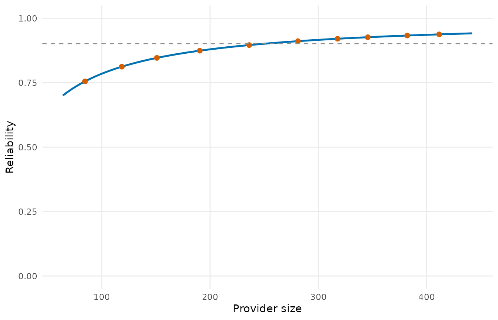

# Reliability

A measure can be fair and still be uninformative: if every provider’s
value is mostly sampling noise, the differences between providers mean
little. **Inter-unit reliability** (IUR) is the fraction of the
variation of a provider-level measure that reflects true differences
between providers rather than within-provider noise (He et al. 2019):

\\\mathrm{IUR} = \frac{\sigma^2_b}{\sigma^2_b + \sigma^2_w / n'} ,\\

with \\\sigma^2_b\\ the between-provider variance of the true measures,
\\\sigma^2_w\\ the within-provider (record-level) variance and \\n'\\ an
effective provider size. A reliability of 0.7 or more is the
conventional threshold for a measure used in public reporting.

## Three estimators

[`iur()`](https://um-kevinhe.github.io/pprof/reference/iur.md) offers
three ways of estimating the decomposition, chosen by `method`:

- `"direct"`: from provider-level estimates and their standard errors
  (for instance a directly standardized rate and its `se_rate`). The
  within variance is the pooled squared standard error.
- `"bootstrap"`: from the rows of every provider, resampled with
  replacement within provider; the variance of the resampled measures is
  the within-provider variance. The measure is the ratio of sums \\\sum
  O / \sum E\\ by default, or any function of (observed, expected,
  provider) you pass as `measure`.
- `"split_half"`: every provider’s rows are split into two random halves
  and the agreement of the two halves’ measures across providers is
  converted into a reliability by the Spearman-Brown formula \\2r / (1 +
  r)\\, with six agreement coefficients (weighted kappa, Kendall’s tau
  and Spearman’s rho of the measures cut into ordered categories, and
  Pearson’s r, Kendall’s tau and Spearman’s rho of the measures
  themselves).

``` r

library(pprof)
d <- sim_kecc(n_providers = 80, provider_size = c(20, 120), seed = 5)
pd <- pp_data(d, y = "y", x = c("x1", "x2", "x3"), provider = "provider",
              patient = "patient", message = FALSE)
fit <- fit_logistic_fe(pd)
expected <- stats::plogis(stats::median(coef(fit)$gamma) + fit$linear_predictor)

boot <- iur("bootstrap", obs = fit$data$y, expected = expected, provider = fit$data$provider,
            n_boot = 100, seed = 1)
boot
#> Bootstrap inter-unit reliability: 0.9017 (80 providers)
#>   between variance 0.1025, within variance 2.807, effective size 251.3
```

The direct estimator from a standardized rate and its standard error:

``` r

tst <- test(fit, statistic = "wald", variance = "robust")
rate <- standardize(fit, type = "direct", gamma_se = stats::setNames(tst$se, tst$provider))
iur("direct", estimate = rate$rate, se = rate$se_rate, size = fit$sizes$patients)
#> Direct inter-unit reliability: 0.894 (80 providers)
#>   between variance 0.006379, within variance 0.05402, effective size 71.44
```

And the split-half estimator:

``` r

iur("split_half", obs = fit$data$y, expected = expected, provider = fit$data$provider,
    n_iter = 20, seed = 1)
#> Split-half inter-unit reliability (20 splits, 80 providers)
#>        kappa  kendall_cat spearman_cat      pearson      kendall     spearman 
#>       0.6659       0.7491       0.8098       0.8765       0.7250       0.8631
```

## Reliability by provider size

The reliability of one provider’s value depends on its size:
\\\sigma^2_b / (\sigma^2_b + \sigma^2_w / n_i)\\.
[`iur_curve()`](https://um-kevinhe.github.io/pprof/reference/iur_curve.md)
evaluates it at the deciles of the size distribution,
[`iur_stratified()`](https://um-kevinhe.github.io/pprof/reference/iur_stratified.md)
repeats the whole decomposition within strata of providers, and
[`plot()`](https://rdrr.io/r/graphics/plot.default.html) draws the
curve:

``` r

iur_curve(boot, n_quantiles = 5)
#>   size_group     size       iur
#> 1        min  64.0000 0.7002832
#> 2 quantile 1 101.5000 0.7874834
#> 3 quantile 2 170.6875 0.8617138
#> 4 quantile 3 258.6250 0.9042307
#> 5 quantile 4 331.6875 0.9237171
#> 6 quantile 5 396.8750 0.9354378
#> 7        max 442.0000 0.9416445
iur_stratified(boot, cuts = c(40, 80))
#>            stratum n_providers       iur
#> 1              all          80 0.9017072
#> 2  40 < size <= 80           5 0.8990621
#> 3 80 < size <= 442          75 0.9015199
plot(boot)
```



## Reading the result

- `iur`: the overall reliability; `iur_providers`: each provider’s
  reliability at its own size.
- `s2_between`, `s2_within`, `n_prime`: the components. A negative
  between variance (a measure that does not vary between providers more
  than noise would make it) is reported as a reliability of 0 with a
  warning.
- For the bootstrap, `replicates` holds the resampled measures, so that
  the Monte Carlo error can be judged by rerunning with another seed.

## Reference

He K, Kalbfleisch JD, Yang Y, Li Y (2019). Inter-unit reliability for
nonlinear models. *Statistics in Medicine*, 38(5), 844-854.
