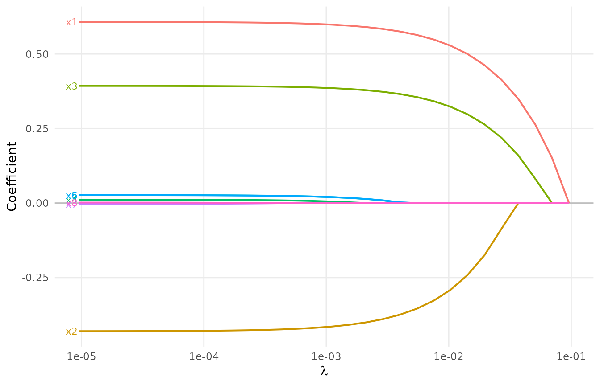
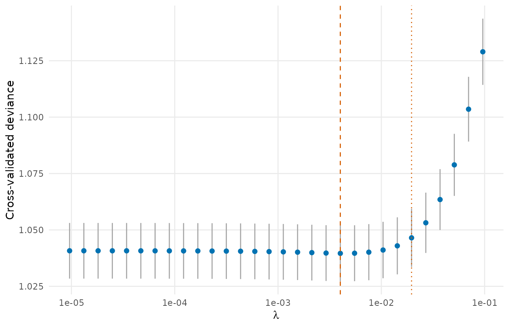

# Variable selection

A measure carries a risk-adjustment set of tens to hundreds of candidate
variables. Which of them the model should keep is a selection problem,
and it has one feature that ordinary penalized regression does not
handle: the provider effects must stay in the model, unpenalized, while
the risk factors are selected. Selecting on a pooled model (without
provider effects) inflates the false discoveries, because the omitted
provider effect acts as a confounder shared by every risk factor
correlated with it.

[`var_select()`](https://um-kevinhe.github.io/pprof/reference/var_select.md)
fits the lasso or group-lasso path of the fixed-effect model with the
provider effects kept, for binary, binomial and survival outcomes;
[`cv()`](https://um-kevinhe.github.io/pprof/reference/cv.md) chooses the
penalty by cross-validation.

## The objective

\\-\frac{1}{n}\\\ell(\gamma, \beta) + \lambda \sum_j m_j \|\beta_j\|
\qquad\text{or}\qquad -\frac{1}{n}\\\ell(\gamma, \beta) + \lambda \sum_g
m_g \\\beta_g\\\_2 ,\\

with the provider effects \\\gamma\\ never penalized. The path is solved
by coordinate descent on standardized covariates (each group
orthonormalized) with one Newton step on the provider effects per cycle,
warm starts along a decreasing sequence of \\\lambda\\ and an active-set
strategy, so that the provider effects are updated in closed form from
their own records and never form indicator columns (the multi-layer
algorithm of the KECC measures paper; `grplasso`’s `pp.lasso` and
`grp.lasso`).

## A lasso path

``` r

library(pprof)
d <- sim_kecc(n_providers = 60, n_covariates = 8, beta = c(0.6, -0.5, 0.4, 0, 0, 0, 0, 0),
              seed = 4)
pd <- pp_data(d, y = "y", x = paste0("x", 1:8), provider = "provider", patient = "patient",
              message = FALSE)
path <- var_select(pd, n_lambda = 30)
path
#> Lasso path of the logistic model with unpenalized provider effects
#>   7292 rows, 60 providers, 8 covariates (8 penalized)
#>   30 values of lambda from 0.09599 to 9.599e-06; selected covariates from 0 to 8
plot(path)
```



- `penalize`: the covariates that carry a penalty (default all); the
  others, a committee’s mandatory adjusters say, enter unpenalized.
- `multiplier`: per-covariate (or per-group) penalty multipliers.
- `lambda`, `n_lambda`, `lambda_min_ratio`: the penalty sequence; by
  default 100 values from the smallest \\\lambda\\ with every penalized
  coefficient zero down to \\10^{-4}\\ times it.

The coefficients at any penalty, and the selected set:

``` r

coef(path, lambda = path$lambda[12])$beta
#>           x1           x2           x3           x4           x5           x6 
#>  0.583846156 -0.389292799  0.372983496  0.000000000  0.008571404  0.008961461 
#>           x7           x8 
#>  0.000000000  0.000000000
selected_covariates(path, which = c(8, 15, 30))
#> $`0.0103925`
#> [1] "x1" "x2" "x3"
#> 
#> $`0.00112512`
#> [1] "x1" "x2" "x3" "x4" "x5" "x6"
#> 
#> $`9.5992e-06`
#> [1] "x1" "x2" "x3" "x4" "x5" "x6" "x7" "x8"
```

## Group lasso

A categorical risk factor coded as several 0/1 columns should enter or
leave the model as a whole. Give each covariate a group label (0 for an
unpenalized covariate); the penalty on a group is \\\sqrt{\text{size}}\\
times the group norm by default.

``` r

grp <- var_select(pd, penalty = "group_lasso", group = c(1, 1, 2, 2, 3, 3, 0, 4), n_lambda = 30)
grp
#> Group-lasso path of the logistic model with unpenalized provider effects
#>   7292 rows, 60 providers, 8 covariates (7 penalized)
#>   30 values of lambda from 0.0721 to 7.21e-06; selected covariates from 0 to 7
selected_covariates(grp, which = 15)
#> $`0.000845114`
#> [1] "x1" "x2" "x3" "x4" "x5" "x6"
```

## Choosing the penalty: cross-validation

[`cv()`](https://um-kevinhe.github.io/pprof/reference/cv.md) refits the
path on every training fold and scores the held-out rows by the binomial
deviance (the partial-likelihood deviance per event for the Cox model,
the person-period deviance for the discrete-time model). Folds are
formed **within every provider** over its patients, so that each
provider is present in every training set; a provider held out entirely
is predicted with the median provider effect.

``` r

cvp <- cv(path, n_folds = 5, seed = 1)
cvp
#> Cross-validated lasso path (5 folds)
#>   lambda_min 0.004008: 5 covariates selected (x1, x2, x3, x5, x6)
#>   lambda_1se 0.01961: 3 covariates selected
plot(cvp)
```



``` r

cvp$selected_min
#> [1] "x1" "x2" "x3" "x5" "x6"
cvp$selected_1se
#> [1] "x1" "x2" "x3"
```

`lambda_min` is the penalty with the smallest cross-validated deviance,
`lambda_1se` the largest penalty within one standard error of it (fewer
variables). For selecting risk adjusters, the measure development work
of the KECC measures uses `lambda_min` and then refits the fixed-effect
model on the selected set:

``` r

pd_sel <- pp_data(d, y = "y", x = cvp$selected_min, provider = "provider",
                  patient = "patient", message = FALSE)
summary(fit_logistic_fe(pd_sel))
#>   covariate    estimate         se  statistic            p       lower
#> 1        x1  0.60743995 0.03160169 19.2217572 0.000000e+00  0.54550179
#> 2        x2 -0.42996348 0.05996075 -7.1707484 7.458885e-13 -0.54748440
#> 3        x3  0.39336177 0.02942045 13.3703497 0.000000e+00  0.33569874
#> 4        x5  0.02679156 0.02911418  0.9202237 3.574559e-01 -0.03027119
#> 5        x6  0.02689037 0.02905516  0.9254938 3.547091e-01 -0.03005669
#>         upper
#> 1  0.66937812
#> 2 -0.31244256
#> 3  0.45102480
#> 4  0.08385430
#> 5  0.08383743
```

## Survival outcomes

On a survival
[`pp_data()`](https://um-kevinhe.github.io/pprof/reference/pp_data.md)
object the same calls fit:

- `model = "cox"` (default): the Cox model stratified by provider (its
  baselines absorb the provider effects), with counting-process rows,
  weights and offsets as in
  [`fit_cox()`](https://um-kevinhe.github.io/pprof/reference/fit_cox.md);
  the cross-validation loss is the partial-likelihood deviance of the
  held-out rows within their own strata.
- `model = "discrete"`: the discrete-time hazard model
  \\\mathrm{logit}\\ h\_{jk} = \alpha_k + \gamma_i + Z_j^\top\beta\\,
  with the periods the distinct event times, one row per subject (no
  `start`), unpenalized period and provider effects and the lasso on
  \\\beta\\. The likelihood is computed without expanding the data into
  person-periods. The provider effects are identified by a zero median.

``` r

s <- sim_kecc(n_providers = 40, rows_per_patient = c(1, 1), type = "survival",
              n_covariates = 6, beta = c(0.6, -0.5, 0.4, 0, 0, 0), seed = 41)
ps <- pp_data(s, x = paste0("x", 1:6), provider = "provider", patient = "patient",
              time = "stop", event = "event", cutoff = 0, message = FALSE)
cox_path <- var_select(ps, n_lambda = 20)
selected_covariates(cox_path, which = 20)
#> $`1.96475e-05`
#> [1] "x1" "x2" "x3" "x4" "x5" "x6"
s$stop <- ceiling(s$stop * 12) / 12   # monthly periods
psm <- pp_data(s, x = paste0("x", 1:6), provider = "provider", patient = "patient",
               time = "stop", event = "event", cutoff = 0, message = FALSE)
disc <- var_select(psm, model = "discrete", n_lambda = 20)
disc
#> Lasso path of the discrete-time hazard model (period and provider effects)
#>   1544 rows, 40 providers, 6 covariates (6 penalized), 24 periods
#>   20 values of lambda from 0.1999 to 1.999e-05; selected covariates from 1 to 6
```

At the smallest penalty of a long path the coefficients approach those
of the unpenalized model:
[`survival::coxph()`](https://rdrr.io/pkg/survival/man/coxph.html) with
`strata(provider)` for the Cox model, a logistic regression on the
expanded person-period data with period and provider indicators for the
discrete-time model.

## References

Breheny P, Huang J (2015). Group descent algorithms for nonconvex
penalized linear and logistic regression models with grouped predictors.
*Statistics and Computing*, 25, 173-187.

Friedman J, Hastie T, Tibshirani R (2010). Regularization paths for
generalized linear models via coordinate descent. *Journal of
Statistical Software*, 33(1), 1-22.
